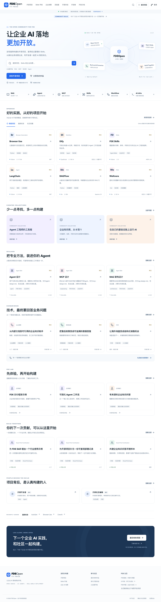

# FDEOpen · FDE开放社区

**让企业 AI 落地更加开放。**

面向 FDE、AI 应用工程师、独立开发者与企业 AI 负责人，发现开源项目、复用 Agent Skills、连接真实业务场景，沉淀可确认的开源贡献。由 FDE前线发起，保持独立品牌；公开内容默认免费阅读。



## 快速运行

要求 Node.js 22.12+、npm。

```bash
npm ci
npm run dev
```

打开 **http://127.0.0.1:3210**。无需密钥即可运行，页面明确标记“本地演示模式”。在 `/login` 选择示例开发者或示例管理员；切换身份前先在工作台退出。数据使用 PGlite（本地 PostgreSQL）持久化到 `.data/fdeopen`，刷新及重启不会丢失。不要让多个进程同时打开同一 PGlite 目录。

开发环境默认演示模式。正式部署必须明确选择 `APP_MODE=supabase`；配置不足时拒绝启动，不会自动退回开放管理员。

## 已实现的核心闭环

- **OpenHub**：项目目录、分类 / 语言 / 许可 / 活跃度 / Stars 筛选、分页搜索、独立详情、来源与许可说明、GitHub 导入与服务端同步、README 纯文本预览。
- **SkillHub**：来源、版本、平台、依赖、安装命令、配置示例、关联资源、收藏与下载来源跳转。
- **ScenarioHub**：20 个明确标为编辑方案的行业场景，包含痛点、流程、实施路径、评测指标及双向关联的项目与 Skills。
- **社区身份**：Supabase GitHub OAuth、演示身份、资料编辑、私密 / 公开档案、联系方式公开开关、作品集、已确认贡献、私人收藏。
- **投稿与编辑**：提交 → 审核 → 发布 → 发布者提出修改 → 再审核；重复审核、越权编辑和非法状态转换被服务端阻止。
- **企业需求**：原始需求和联系信息默认私密；仅获得授权后，编辑另写脱敏内容转为公开任务。
- **FDE Lab**：5 个外部体验 / 教程入口及说明性输入输出；不执行第三方代码、不默认嵌入第三方页面。
- **开源共创**：开放任务 → 申请认领 → 管理员接受 → 提交 GitHub PR → 人工核验 → 贡献记录。无悬赏支付与资金托管。
- **开放文档**：8 篇受 Git 管理的 MDX 文档、章节目录、版本标识、公开检索与关联资源；编辑在线修改正文后按纯文本安全发布。
- **运营后台**：内容增改 / 下架、投稿、私密线索跟进、评论与举报、任务申请、专题、用户角色、首页开关、事件统计和审计日志。
- **SEO**：SSR、规范 URL、Metadata、分享图、JSON-LD、动态 Sitemap、Robots；演示环境不允许搜索引擎索引。

## 初始内容

| 内容     | 数量 | 说明                                                                             |
| -------- | ---: | -------------------------------------------------------------------------------- |
| 项目     |   20 | 2026-10-11 经 GitHub API 核验的真实仓库；Stars 为带日期快照                      |
| Skills   |   20 | 从 `bingyue/fde-skills` 远程 master 分支核验，保留 AGPL 许可与作者，只做目录索引 |
| 企业场景 |   20 | 编辑提出的方案，不冒充已交付的客户成果，不承诺业务收益                           |
| 社区专题 |    5 | 企业 RAG、Agent、浏览器自动化、本地部署、100 项目共建计划                        |
| Lab 条目 |    5 | 原项目服务或教程入口，可能需要独立账号                                           |
| 共创任务 |    3 | 社区发起的文档、评测与行业示例任务                                               |
| 开放文档 |    8 | FDE、RAG、Agent、MCP、AI Coding、交付、生产化、行业实践                          |

来源快照见 [`content/github-sources.json`](content/github-sources.json) 与 [`content/skill-source-verification.json`](content/skill-source-verification.json)。外部项目归原作者所有，收录不代表官方合作。自定义许可或多重许可会明确显示，使用前请阅读原文。

## 项目结构

```text
src/app/                 SSR 页面、OAuth、API、SEO
src/components/          导航、资源卡片、表单、后台组件
src/components/ui/       基于 Radix Slot + CVA 的 shadcn 风格基础按钮
src/lib/                 业务服务、认证、权限、SQL 适配、GitHub 集成
content/                 初始内容与来源证据、MDX 文档
supabase/migrations/     PostgreSQL Schema、关系、索引、RLS
scripts/                 幂等种子、迁移、管理员初始化、部署准备
tests/                  服务层与 RLS 测试、Playwright E2E
docs/                   架构、部署、运营、验收与迭代计划
```

技术栈：Next.js 16.4、React 19.3、TypeScript、Tailwind CSS 4、Radix / shadcn 风格组件、PostgreSQL / Supabase Auth。演示数据库与生产数据库执行相同的参数化 SQL，生产使用 Supabase PostgreSQL 连接与 GitHub OAuth。

## 检查与构建

```bash
npm run lint
npm run typecheck
npm test
npm run build
# 首次运行浏览器验收时，如缺少 Chromium：
npx playwright install chromium
npm run test:e2e
```

E2E 在 3211 端口启动真正的独立生产包，使用一次性的演示数据库和测试口令，不污染 `.data/fdeopen`。报告为 `playwright-report/index.html`，验收截图保存至 `docs/screenshots/`。

`npm run build` 会生成 `.next/standalone` 并准备静态文件。`npm start` 读取根目录 `.env.local`（存在时）并使用独立包启动，默认端口 3210。生产模式不会自动创建演示身份。

## 生产配置

复制 `.env.example` 为 `.env.local`，根据[部署手册](docs/DEPLOYMENT.md)配置专用 Supabase 项目、GitHub OAuth、HTTPS 域名和服务端数据库连接，执行迁移与种子，然后建立第一个管理员。

```bash
npm run db:migrate
npm run db:seed
# 先让本人通过 GitHub 登录，再核对应用 users 表中的 UUID
npm run admin:grant -- USER_UUID --confirm
npm run build
npm start
```

**交付状态**：本地与独立部署包已验收；没有创建远程仓库、购买或绑定域名、部署线上站点。真实 OAuth、Vercel 和 Supabase 托管环境需由实际部署凭据完成联调。详细边界见[验收记录](docs/ACCEPTANCE.md)。

## 文档

- [建设计划与复用判断](docs/PLAN.md)
- [架构与权限决策](docs/ARCHITECTURE.md)
- [Supabase / Vercel / Docker 部署](docs/DEPLOYMENT.md)
- [运营手册与验收脚本](docs/OPERATIONS.md)
- [验收记录](docs/ACCEPTANCE.md)
- [代码复查与优化记录](docs/CODE-REVIEW-2026-10-11.md)
- [路线图](docs/ROADMAP.md)
- [贡献指南](CONTRIBUTING.md)

代码采用 MIT 许可。第三方项目、Skill 和原文仍适用其原作者许可，索引不改变原资源许可。FDEOpen 原创文档的转载与修改应标明来源。
